<div align="center">

# 🌐 域名配置及项目部署上线完整指南

**从零到一，手把手教你把项目部署到互联网**

[](https://www.cloudflare.com/)
[]()
[]()
[]()

</div>

---

## 📑 目录

| 章节 | 内容 | 难度 |
|:----:|------|:----:|
| 一 | [概述与核心概念](#一概述与核心概念) | ⭐ |
| 二 | [域名购买方案（免费+付费）](#二域名购买方案) | ⭐⭐ |
| 三 | [域名托管与DNS管理](#三域名托管与dns管理) | ⭐⭐ |
| 四 | [内网穿透方案](#四内网穿透方案) | ⭐⭐⭐ |
| 五 | [完整部署流程实战](#五完整部署流程实战) | ⭐⭐⭐ |
| 六 | [常见问题与故障排查](#六常见问题与故障排查) | ⭐⭐ |
| 七 | [安全建议](#七安全建议) | ⭐⭐ |
| 八 | [健身小助手项目关键配置](#八健身小助手项目关键配置细节) | ⭐⭐⭐ |
| 九 | [免费域名注册详细指南](#九免费域名注册详细指南) | ⭐ |

---

## 一、概述与核心概念

本文档详细介绍了从域名购买到项目上线的完整流程，涵盖 🆓 **免费方案** 和 💰 **付费方案**，适用于个人项目、测试环境以及小型生产环境的部署需求。

### 📖 核心概念速查

| 概念 | 说明 | 类比 |
|:----:|------|------|
| 🏠 **域名 (Domain)** | 网站的地址，如 `example.com` | 门牌号 |
| 📡 **DNS** | 域名解析系统，将域名转换为IP | 114查号台 |
| 🗂️ **名称服务器 (NS)** | 管理域名DNS记录的服务器 | 物业管理处 |
| 📍 **A记录** | 将域名指向IPv4地址 | 门牌号→具体坐标 |
| 🔗 **CNAME记录** | 将域名指向另一个域名 | 别名/转发 |
| 🚇 **内网穿透** | 将本地服务暴露到公网 | 地下通道 |

### 🛠️ 推荐技术栈

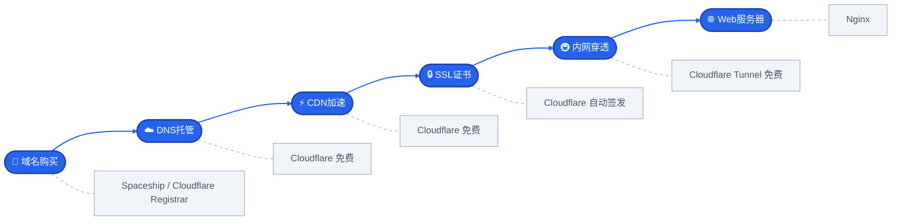

---

## 二、域名购买方案

### 2.1 🆓 免费域名方案

#### 🥇 方案A: EU.org 二级域名

> 💡 **最推荐** — 永久免费、无需续期、完全兼容 Cloudflare

| 项目 | 详情 |
|------|------|
| 🌐 域名格式 | `yourname.eu.org` |
| 🔗 注册地址 | https://nic.eu.org/ |
| 💰 费用 | 🆓 **完全免费** |
| ⏳ 审核时间 | 3-7个工作日 |
| ✏️ 支持NS修改 | ✅ 支持 |
| ☁️ 可绑定Cloudflare | ✅ 支持 |
| 📅 运营时间 | 始于1996年，近30年历史 |

**注册步骤**：

> **Step 1** → 访问 https://nic.eu.org/ 点击 `Register`
> 
> **Step 2** → 填写用户名、邮箱、密码，完成验证码验证
> 
> **Step 3** → 登录后选择 `Apply for a domain` → `Second-level domain`
> 
> **Step 4** → 输入期望的域名前缀（如 `fitness-app`）
> 
> **Step 5** → 填写用途说明（英文），例如：`Personal fitness tracking application`
> 
> **Step 6** → 提交申请等待人工审核

---

#### 🥈 方案B: DNSHe 免费顶级域名

> 💡 **即时生效** — 支持多种后缀、国内平台

| 项目 | 详情 |
|------|------|
| 🌐 支持后缀 | `.tk` `.ml` `.ga` `.cf` `.gq` |
| 🔗 注册地址 | https://my.dnshe.com/ |
| 💰 费用 | 🆓 免费（每人最多3个） |
| ⏳ 审核时间 | ⚡ 即时生效 |
| ☁️ Cloudflare兼容 | ✅ 支持 |

---

#### 🥉 方案C: deSEC 免费二级域名

| 项目 | 详情 |
|------|------|
| 🌐 域名格式 | `yourname.dedyn.io` |
| 🔗 注册地址 | https://desec.io/ |
| 💰 费用 | 🆓 免费 |
| 📊 解析记录 | 不限数量 |
| ☁️ Cloudflare兼容 | ✅ 支持 |

---

#### 方案D: ClouDNS 免费二级域名

> ⚠️ **注意**: 不支持托管到 Cloudflare 免费计划

| 项目 | 详情 |
|------|------|
| 🌐 域名格式 | `yourname.abrdns.com` / `yourname.cloud-ip.cc` |
| 🔗 注册地址 | https://www.cloudns.net/ |
| 💰 费用 | 🆓 永久免费 |
| 📊 解析记录 | 50条/域名 |
| ☁️ Cloudflare兼容 | ❌ 不支持免费计划 |

---

#### 📊 免费域名方案对比

| 特性 | 🥇 EU.org | 🥈 DNSHe | 🥉 deSEC | ClouDNS |
|:----:|:---------:|:--------:|:--------:|:-------:|
| 域名类型 | 二级域 | 顶级域 | 二级域 | 二级域 |
| 费用 | 🆓 | 🆓 | 🆓 | 🆓 |
| 审核时间 | 3-7天 | ⚡即时 | ⚡即时 | ⚡即时 |
| NS自定义 | ✅ | ✅ | ✅ | ❌ |
| Cloudflare兼容 | ✅ | ✅ | ✅ | ❌ |
| SEO友好度 | ⭐⭐⭐ | ⭐⭐ | ⭐⭐⭐ | ⭐ |
| 推荐指数 | ⭐⭐⭐⭐⭐ | ⭐⭐⭐ | ⭐⭐⭐ | ⭐⭐ |

> 💡 **提示**: 如果条件允许，建议使用付费顶级域名（如 `.com`），对SEO和品牌形象更有利。

---

### 2.2 💰 付费域名方案

#### 🏆 推荐: Spaceship（性价比最高）

> ✨ 价格便宜 · 支持支付宝 · 新人优惠力度大 · WHOIS隐私免费

| 项目 | 详情 |
|------|------|
| 🔗 官网 | https://www.spaceship.com/ |
| 💳 支付方式 | 💚 **支付宝** · 信用卡 · PayPal |
| 💲 .com首年 | 约 **$0.99-$9.99**（活动价） |
| 💲 续费价格 | 约 $10-12/年 |
| 🔒 WHOIS隐私 | 🆓 免费赠送 |
| 🔄 域名转移 | 费用低廉 |

**各后缀详细价格**：

| 后缀 | 首年价 | 续费价 | 适合场景 | 推荐度 |
|:----:|:------:|:------:|----------|:------:|
| `.com` | $0.99-$8.88 | ~$10.98 | 🏆 通用首选 | ⭐⭐⭐⭐⭐ |
| `.net` | $6.98 | ~$11.98 | 技术社区/网络服务 | ⭐⭐⭐⭐ |
| `.org` | $5.98 | ~$10.98 | 非营利组织/开源项目 | ⭐⭐⭐⭐ |
| `.dev` | $8.98 | ~$14.98 | 开发者项目（强制HTTPS） | ⭐⭐⭐ |
| `.app` | $8.98 | ~$14.98 | 移动应用（强制HTTPS） | ⭐⭐⭐ |
| `.site` | $1.98 | ~$10.98 | 个人站点 | ⭐⭐⭐ |
| `.xyz` | $0.99 | ~$12.98 | 创意项目/测试 | ⭐⭐⭐ |
| `.me` | $2.98 | ~$16.98 | 个人品牌 | ⭐⭐⭐ |
| `.io` | $25.98 | ~$39.98 | 科技/创业公司 | ⭐⭐ |
| `.cc` | $4.98 | ~$12.98 | 商业/社区 | ⭐⭐ |

> ⚠️ **注意**: 首年价格为活动价，实际价格以官网为准。`.dev` 和 `.app` 后缀强制要求 HTTPS（HSTS预加载），部署时需确保SSL配置正确。

**购买步骤**：

> **Step 1** → 访问 Spaceship 官网，搜索想要的域名
> 
> **Step 2** → 选择域名后缀（推荐 `.com` `.net` `.org`）
> 
> **Step 3** → 加入购物车，确保开启 🆓 **Domain Privacy**
> 
> **Step 4** → 使用 💚 **支付宝** 完成支付
> 
> **Step 5** → 在 **Domain Manager** 中查看已购域名

---

#### 📋 其他付费平台对比

| 平台 | .com首年价 | 续费价 | WHOIS隐私 | 💚 支付宝 | 隐藏费用 | 推荐度 |
|:----:|:---------:|:------:|:---------:|:--------:|:--------:|:------:|
| **Spaceship** | $0.99起 | ~$11 | 🆓免费 | ✅ | 无 | ⭐⭐⭐⭐⭐ |
| **Namecheap** | $5.98起 | ~$13 | 🆓首年 | ❌ | WHOIS续费$2.88/年 | ⭐⭐⭐⭐ |
| **Cloudflare Registrar** | ~$9.77 | ~$9.77 | 🆓免费 | ❌ | 无加价 | ⭐⭐⭐⭐ |
| **阿里云** | ¥29起 | ¥69 | 💲付费 | ✅ | 实名认证费 | ⭐⭐⭐ |
| **腾讯云** | ¥29起 | ¥69 | 💲付费 | ✅ | 实名认证费 | ⭐⭐⭐ |
| **GoDaddy** | $0.99起 | ~$17 | 💲$11.99/年 | ❌ | ⚠️续费陷阱多 | ⭐⭐ |

> ⚠️ **GoDaddy 避坑指南**: 首年 $0.99 诱惑价，但续费高达 $17+/年，WHOIS隐私需额外付费 $11.99/年，自动续费默认开启且退款困难。**不推荐长期使用。**

---

#### 💡 Cloudflare Registrar 成本价说明

> Cloudflare Registrar 承诺以域名注册局的批发价（Wholesale Price）出售域名，不加任何利润。这是由 ICANN 规定的注册局基准价格。

| 后缀 | Cloudflare成本价 | Namecheap续费 | Spaceship续费 | 节省幅度 |
|:----:|:---------------:|:-------------:|:-------------:|:--------:|
| `.com` | ~$9.77/年 | ~$13.98/年 | ~$10.98/年 | 最多省30% |
| `.net` | ~$10.97/年 | ~$14.98/年 | ~$11.98/年 | 最多27% |
| `.org` | ~$9.93/年 | ~$14.98/年 | ~$10.98/年 | 最多34% |
| `.dev` | ~$12.18/年 | ~$18.98/年 | ~$14.98/年 | 最多36% |

> 💡 **使用条件**: 域名必须先托管到 Cloudflare（修改NS），才能使用 Cloudflare Registrar 购买或转入。不支持支付宝，需信用卡或PayPal。

---

#### 🏷️ 域名后缀选择指南

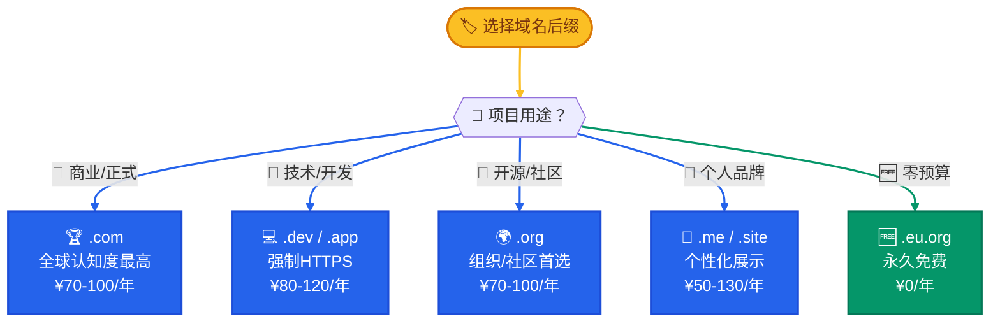

---

### 2.3 🌳 域名选择决策树

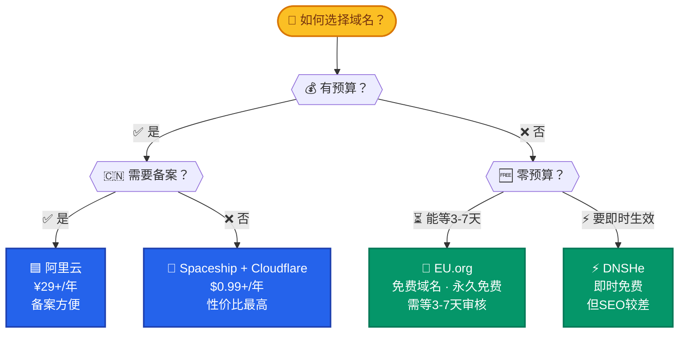

---

## 三、域名托管与DNS管理

### 3.1 ☁️ Cloudflare 托管流程（推荐）

> 📖 **参考来源**: [CSDN - 我把 Spaceship 域名托管到 Cloudflare](https://blog.csdn.net/qq_42072085/article/details/160965108)

#### 🎯 为什么选择 Cloudflare？

| 功能 | 免费版 | 说明 |
|:----:|:------:|------|
| ⚡ CDN加速 | ✅ | 全球200+节点 |
| 🛡️ DDoS防护 | ✅ | 基础防护 |
| 🔒 SSL证书 | ✅ | 自动签发和续期 |
| 📡 DNS解析 | ✅ | 无限域名/记录 |
| 💾 缓存优化 | ✅ | 页面规则 |
| 🔥 防火墙规则 | ✅ | 5条自定义规则 |
| 📊 分析统计 | ✅ | 基础流量分析 |

---

#### 💰 Cloudflare 计划对比

> 💡 个人项目和小型站点完全够用免费版，以下为需要进阶功能时的参考

| 功能 | 🆓 Free | 💎 Pro $20/月 | 🏢 Business $200/月 | 🏭 Enterprise 定制 |
|:----:|:-------:|:------------:|:-------------------:|:------------------:|
| CDN & DDoS防护 | ✅ | ✅ | ✅ | ✅ |
| SSL证书 | ✅ 通用 | ✅ 通用 | ✅ 自定义 | ✅ 自定义 |
| WAF防火墙 | ❌ 5条基础 | ✅ 完整规则集 | ✅ 完整+自定义 | ✅ 高级定制 |
| Bot防护 | 基础 | ✅ 超级Bot | ✅ 超级Bot | ✅ 企业级 |
| 页面规则 | 3条 | 20条 | 50条 | 不限 |
| 缓存清除 | 逐文件 | ✅ 按URL | ✅ 按标签 | ✅ 高级 |
| 分析统计 | 基础 | ✅ 30天详细 | ✅ 90天详细 | ✅ 实时日志 |
| 图片优化 | ❌ | ✅ Polish | ✅ Polish+Mirage | ✅ 完整 |
| 负载均衡 | ❌ | ❌ | ✅ | ✅ |
| 100% SLA | ❌ | ❌ | ✅ | ✅ |
| 技术支持 | 社区 | ✅ 邮件 | ✅ 聊天 | ✅ 专属 |

> 🏆 **推荐**: 个人项目选 **Free** 即可。如果需要 WAF 防火墙规则放行 API（参考 7.4 节），**Pro 计划**是最低选择。

---

#### 🔒 SSL 证书费用说明

| 方案 | 费用 | 适用场景 | 说明 |
|:----:|:----:|----------|------|
| ☁️ **Cloudflare SSL** | 🆓 免费 | 🏆 首选推荐 | 自动签发+续期，零配置 |
| 🔑 **Let's Encrypt** | 🆓 免费 | 自建服务器 | 90天自动续期，需 certbot |
| 💲 **DigiCert** | $200+/年 | 企业级 | OV/EV证书，浏览器绿标 |
| 💲 **Sectigo** | $50+/年 | 中小企业 | DV/OV证书 |
| 💲 **通配符证书** | $100+/年 | 多子域名 | 覆盖 `*.example.com` |

> 💡 **省钱建议**: 使用 Cloudflare 托管域名后，SSL 证书由 Cloudflare 免费自动提供，无需额外购买。即使源站是 HTTP，Cloudflare 到用户之间也是 HTTPS（Flexible SSL模式）。

---

#### 📝 第一步：在 Cloudflare 添加域名

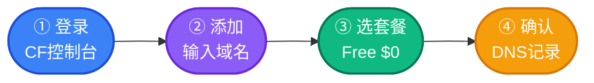

**详细步骤**：

1. 访问 https://dash.cloudflare.com 登录账号
2. 点击右上角 **「添加站点」** 或 **「Add Site」**
3. 选择 **「连接域」(Connect a domain)**
4. 输入你的根域名（如 `fitness-app.com`，⚠️ 不要加 www 或 http）
5. 选择套餐：**Free ($0)** — 个人项目完全够用
6. Cloudflare 会自动扫描现有DNS记录，确认无误后点击继续
7. **🔑 重要！复制两个 Nameserver 地址**：

> 📋 **Cloudflare 分配的名称服务器**（示例，以实际为准）
> 
> | # | Nameserver |
> |:---:|:-----------|
> | 1 | `xxx.ns.cloudflare.com` |
> | 2 | `yyy.ns.cloudflare.com` |

---

#### 📝 第二步：在域名注册商更新名称服务器

**如果是 Spaceship 购买的域名**：

> ① 登录 Spaceship 后台 → ② 进入 **Domain Manager** → ③ 点击域名详情
> 
> ④ 点击 **「Nameservers & DNS」** → ⑤ 选择 **Custom nameservers**
> 
> ⑥ 填入 Cloudflare 提供的两个 NS 地址 → ⑦ 点击 **保存**

**其他平台 NS 修改位置**：

| 平台 | NS修改路径 |
|------|-----------|
| 🟦 阿里云 | 域名列表 → 管理 → DNS修改 → 修改DNS服务器 |
| 🟩 腾讯云 | 域名管理 → 修改DNS服务器 |
| 🟨 Namecheap | Domain List → Manage → Nameservers |
| 🟧 GoDaddy | My Products → DNS → Nameservers |

---

#### 📝 第三步：等待激活

| 时间 | 说明 |
|:----:|------|
| ⚡ 10分钟-1小时 | 通常生效时间 |
| 🕐 最长24小时 | 某些情况需要更久 |
| 📧 邮件通知 | 成功后 Cloudflare 会发邮件 |

> 💡 可以点击 **「立即检查名称服务器」** 手动触发检查

---

#### 📝 第四步：配置DNS记录

登录 Cloudflare Dashboard，添加以下常见记录：

```dns
; ═══════ 主站 ═══════
A       @           你的服务器IP          ☁️ Proxied
A       www         你的服务器IP          ☁️ Proxied

; ═══════ API服务 ═══════
A       api         你的服务器IP          ☁️ Proxied

; ═══════ 平台托管 ═══════
CNAME   @           your-app.vercel.app  ☁️ Proxied
CNAME   www         your-app.vercel.app  ☁️ Proxied
```

> ⚠️ **注意**: ☁️ **Proxied**（橙色云朵）= 经过Cloudflare代理，隐藏真实IP + CDN加速。如需直连源站，选择 **DNS only**（灰色云朵）。

---

### 3.2 🔄 其他DNS托管方案

| 服务商 | 免费版限制 | 特色功能 | 适用场景 |
|--------|:----------:|----------|----------|
| ☁️ **Cloudflare** | 无限域名/记录 | CDN+SSL+防护 | 🏆 首选推荐 |
| 🟦 阿里云DNS | 5个域名 | 国内解析快 | 国内项目 |
| 🟩 腾讯云DNSPod | 10个域名 | 国内稳定 | 国内项目 |
| 🟨 Google DNS | 随域名赠送 | 全球稳定 | 海外项目 |

---

## 四、内网穿透方案

### 4.1 🆓 免费内网穿透工具

#### 🥇 cpolar（推荐新手）

> ✨ 永久免费 · 不限制流量 · 中文界面 · 教程完善

| 项目 | 详情 |
|------|------|
| 🔗 官网 | https://www.cpolar.com/ |
| 📡 支持协议 | HTTP / HTTPS / TCP |
| 🚀 免费带宽 | 1Mbps |
| 📊 免费流量 | **♾️ 不限流量** |
| 🔧 隧道数量 | 4条 |
| ⏱️ 连接数限制 | 40次/分钟 |
| 🔗 地址变化 | 24h内随机变化（付费可固定） |

**快速开始**：

```bash
# ① 访问官网下载客户端 → ② 注册账号并登录 → ③ 创建隧道
cpolar http 8080

# ✅ 输出示例:
# Forwarding    https://xxxxxxxx.cpolar.top -> http://localhost:8080
```

---

#### 🥈 Natapp

| 项目 | 详情 |
|------|------|
| 🔗 官网 | https://natapp.cn/ |
| 📡 支持协议 | HTTP / TCP / UDP |
| 🚀 免费带宽 | 1M |
| 📊 免费流量 | ♾️ 不限 |
| 🔧 隧道数量 | 2条 |
| ⚠️ 注意 | 需实名认证；不定时更换域名/端口 |

---

#### 🥉 SAKURA FRP

| 项目 | 详情 |
|------|------|
| 🔗 官网 | https://www.natfrp.com/ |
| 📡 支持协议 | HTTP / HTTPS / TCP / UDP |
| 🚀 免费带宽 | **10Mbps**（较高！） |
| 📊 免费流量 | 5GB/月（每日签到可获取更多） |
| 🔧 隧道数量 | 2条 |
| ⚠️ 注意 | HTTP/HTTPS隧道需实名认证 |

---

#### 花生壳（老牌）

| 项目 | 详情 |
|------|------|
| 🔗 官网 | https://hsk.oray.com/ |
| 📡 支持协议 | HTTP / HTTPS / TCP |
| 🚀 免费带宽 | 1Mbps |
| 📊 免费流量 | 1GB/月 |
| 🔧 隧道数量 | 2条 |
| ⚠️ 注意 | 需实名认证；HTTP(S)需6元认证费 |

---

#### Ngrok（国际知名）

| 项目 | 详情 |
|------|------|
| 🔗 官网 | https://ngrok.com/ |
| 📡 支持协议 | HTTP / HTTPS / TCP |
| 🚀 免费限制 | 随机域名、限速、在线时长限制 |
| 🎯 特色 | 开箱即用、国际通用 |

**快速使用**：

```bash
# ① 注册并下载 → ② 认证
ngrok config add-authtoken YOUR_TOKEN

# ③ 启动穿透
ngrok http 8080

# ✅ 输出:
# Forwarding    https://xxxx.ngrok-free.app -> http://localhost:8080
```

---

### 4.2 💰 付费内网穿透服务

| 服务 | 月费 | 带宽 | 特色 | 适用场景 |
|:----:|:----:|:----:|------|----------|
| cpolar基础版 | ¥49/月 | 2M | 固定地址、不限流量 | 个人长期使用 |
| 花生壳旗舰版 | ¥198/月 | 5M | 高带宽、企业级 | 企业商用 |
| SAKURA FRP会员 | ¥10起/月 | 按需 | 高性价比 | 技术玩家 |
| 快解析 | ¥58/月 | 2M | 国产、售后好 | 国内中小企业 |

---

### 4.3 🔧 自建内网穿透方案

#### 方案A: FRP（最流行的开源方案）

> 🆓 完全免费开源，但需要一台有公网IP的服务器

| 项目 | 详情 |
|------|------|
| 🔗 GitHub | https://github.com/fatedier/frp |
| 💻 语言 | Go |
| 🏗️ 架构 | 客户端-服务端 (frpc / frps) |
| 📡 支持协议 | TCP / UDP / HTTP / HTTPS |
| 💰 费用 | 🆓 免费（需自备服务器） |

**架构图**：

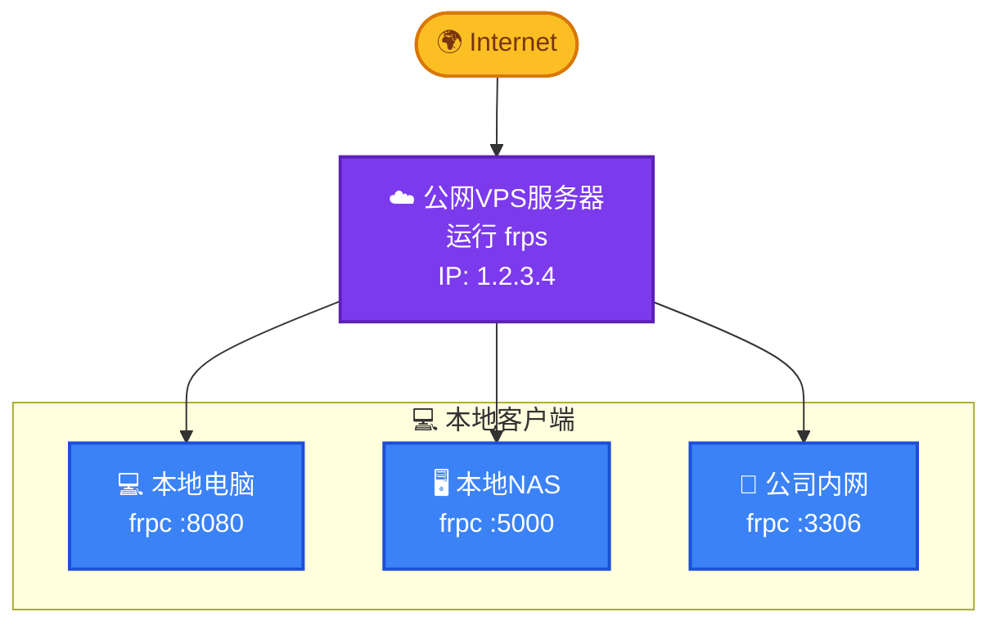

**服务端配置 (frps.toml)**：

```toml
bindPort = 7000
vhostHTTPPort = 80
vhostHTTPSPort = 443
```

**客户端配置 (frpc.toml)**：

```toml
serverAddr = "你的公网服务器IP"
serverPort = 7000

[[proxies]]
name = "web"
type = "http"
localPort = 8080
customDomains = ["yourdomain.com"]

[[proxies]]
name = "ssh"
type = "tcp"
localIP = "127.0.0.1"
localPort = 22
remotePort = 6000
```

---

#### 方案B: Cloudflare Tunnel（🏆 强烈推荐）

> 🆓 完全免费 · 不需要公网服务器 · 自动HTTPS · DDoS防护 · 隐藏源站IP

| 项目 | 详情 |
|------|------|
| 📖 官方文档 | https://developers.cloudflare.com/cloudflare-one/connections/connect-networks/ |
| 💰 费用 | 🆓 免费（50用户以内） |
| 📋 需求 | 一个域名（托管在Cloudflare即可） |
| ✅ 优势 | 自动HTTPS · DDoS防护 · 隐藏源站IP |

**安装步骤**：

```bash
# ═══════ ① 安装 cloudflared ═══════

# Windows:
winget install Cloudflare.cloudflared

# macOS:
brew install cloudflared

# Linux:
curl -L https://github.com/cloudflare/cloudflared/releases/latest/download/cloudflared-linux-amd64 -o cloudflared
chmod +x cloudflared && sudo mv cloudflared /usr/local/bin/

# ═══════ ② 登录认证 ═══════
cloudflared tunnel login

# ═══════ ③ 创建隧道 ═══════
cloudflared tunnel create my-tunnel

# ═══════ ④ 配置隧道 (~/.cloudflared/config.yml) ═══════
```

```yaml
tunnel: my-tunnel
credentials-file: /home/user/.cloudflared/<tunnel-id>.json

ingress:
  - hostname: app.yourdomain.com
    service: http://localhost:8080
  - hostname: api.yourdomain.com
    service: http://localhost:3000
  - service: http_status:404
```

```bash
# ═══════ ⑤ 配置DNS路由 ═══════
cloudflared tunnel route dns my-tunnel app.yourdomain.com
cloudflared tunnel route dns my-tunnel api.yourdomain.com

# ═══════ ⑥ 运行隧道 ═══════
cloudflared tunnel run my-tunnel
```

**设置为系统服务（开机自启）**：

```bash
# Linux systemd
sudo cloudflared service install
sudo systemctl start cloudflared
sudo systemctl enable cloudflared
```

---

### 4.4 📊 内网穿透工具全景对比

| 工具 | 类型 | 费用 | 带宽 | 流量 | 上手难度 | 固定地址 | 推荐场景 |
|:----:|:----:|:----:|:----:|:----:|:--------:|:--------:|----------|
| cpolar | 公共 | 免费增值 | 1M | ♾️ | ⭐极低 | 💰可选 | 新手首选 |
| Natapp | 公共 | 免费增值 | 1M | ♾️ | ⭐低 | ❌ | 快速测试 |
| SAKURA FRP | 公共 | 免费增值 | **10M** | 5G/月 | ⭐低 | 💰可选 | 高带宽 |
| 花生壳 | 商业 | 有限免费 | 1M | 1G/月 | ⭐低 | 💰可选 | 家用设备 |
| Ngrok | 公共 | 有限免费 | 有限 | 有限 | ⭐⭐中 | 💰可选 | 国际项目 |
| FRP | 自建 | 🆓 | 取决服务器 | ♾️ | ⭐⭐⭐高 | ✅ | 技术玩家 |
| **CF Tunnel** | 自建+商业 | 🆓 | ♾️ | ♾️ | ⭐⭐中 | ✅ | 🏆 **强烈推荐** |

---

## 五、完整部署流程实战

### 5.1 🏗️ 方案一：域名 + 云服务器部署

> 🎯 **适用场景**: 生产环境 · 正式上线 · 需要稳定性和性能
> 
> 💰 **预估成本**: ¥50-100/月

#### 架构图

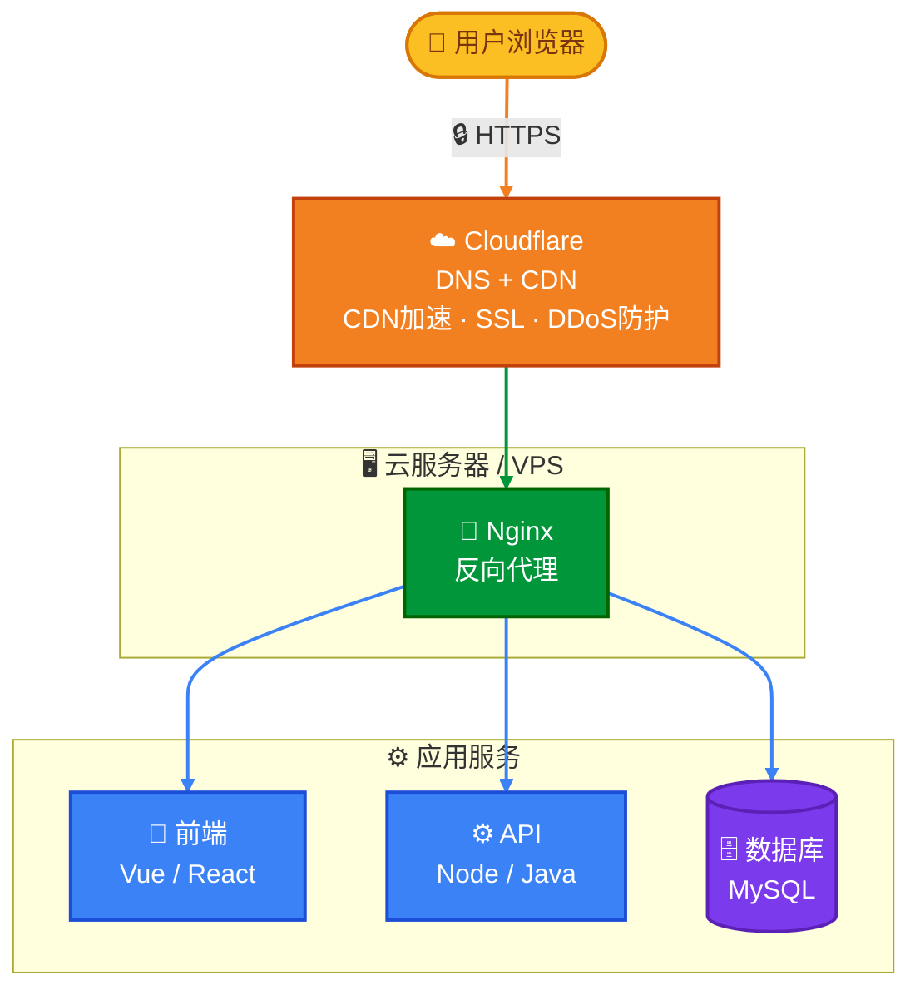

#### 步骤详解

**Step 1: 🛒 购买域名**

```bash
# 推荐使用 Spaceship（支持支付宝）
# 1. 访问 https://www.spaceship.com/
# 2. 搜索域名（如 fitness-pro.com）
# 3. 加入购物车，使用支付宝支付
# 4. 等待域名生效（通常即时）
```

**Step 2: 🖥️ 购买云服务器**

| 平台 | 入门配置 | 价格 | 推荐理由 |
|:----:|:--------:|:----:|----------|
| 阿里云ECS | 2核2G | ¥50-100/月 | 国内访问快、备案方便 |
| 腾讯云CVM | 2核2G | ¥50-100/月 | 新用户优惠多 |
| AWS Lightsail | 512MB/1核 | $3.5/月 | 海外项目首选 |
| Vultr | 1核1GB | $5/月 | 按小时计费、全球节点 |
| Racknerd | 1核1GB | $10-15/年 | 超高性价比 |

**Step 3: ☁️ 托管域名到 Cloudflare**

参考 [3.1 Cloudflare 托管流程](#31-cloudflare-托管流程推荐)

**Step 4: ⚙️ 配置服务器环境**

```bash
# 以 Ubuntu 为例

# 🔄 更新系统
sudo apt update && sudo apt upgrade -y

# 🌐 安装 Nginx
sudo apt install nginx -y

# 💻 安装 Node.js
curl -fsSL https://deb.nodesource.com/setup_18.x | sudo -E bash -
sudo apt install nodejs -y

# 🔄 安装 PM2 (进程管理器)
sudo npm install pm2@latest -g

# 🗄️ 安装 MySQL
sudo apt install mysql-server -y
```

**Step 5: 📦 部署应用代码**

```bash
# 克隆项目
git clone https://github.com/yourusername/fitness-app.git
cd fitness-app

# 安装依赖并构建前端
npm install
npm run build:h5

# 复制构建产物到 Nginx 目录
sudo cp -r dist/build/h5/* /var/www/html/
```

**Step 6: 🌐 配置 Nginx**

```nginx
# /etc/nginx/sites-available/fitness-app
server {
    listen 80;
    server_name fitness-pro.com www.fitness-pro.com;
    root /var/www/html;
    index index.html;

    location / {
        try_files $uri $uri/ /index.html;
    }

    # API反向代理
    location /api {
        proxy_pass http://localhost:8888;
        proxy_set_header Host $host;
        proxy_set_header X-Real-IP $remote_addr;
    }

    # Gzip压缩
    gzip on;
    gzip_types text/plain text/css application/json application/javascript text/xml;
}
```

```bash
# 启用配置
sudo ln -s /etc/nginx/sites-available/fitness-app /etc/nginx/sites-enabled/
sudo nginx -t && sudo systemctl reload nginx
```

**Step 7: ☁️ 配置 Cloudflare DNS**

| 类型 | 名称 | 内容 | 代理状态 |
|:----:|:----:|------|:--------:|
| A | @ | 你的服务器IP | ☁️ 已代理 |
| A | www | 你的服务器IP | ☁️ 已代理 |

**Step 8: 🔒 配置 SSL**

Cloudflare 会自动提供SSL证书，设置：
- SSL/TLS 加密模式: **Flexible** 或 **Full**
- 始终使用 HTTPS: ✅ **开启**
- HSTS: ✅ **开启**

**Step 9: ✅ 最终验证**

```bash
# 测试DNS解析
nslookup fitness-pro.com

# 测试HTTPS访问
curl -I https://fitness-pro.com

# 检查SSL证书
openssl s_client -connect fitness-pro.com:443 -servername fitness-pro.com
```

---

### 5.2 🚇 方案二：免费域名 + 内网穿透部署

> 🎯 **适用场景**: 个人测试 · 开发调试 · 临时展示 · 无预算项目
> 
> 💰 **预估成本**: ¥0

#### 架构图

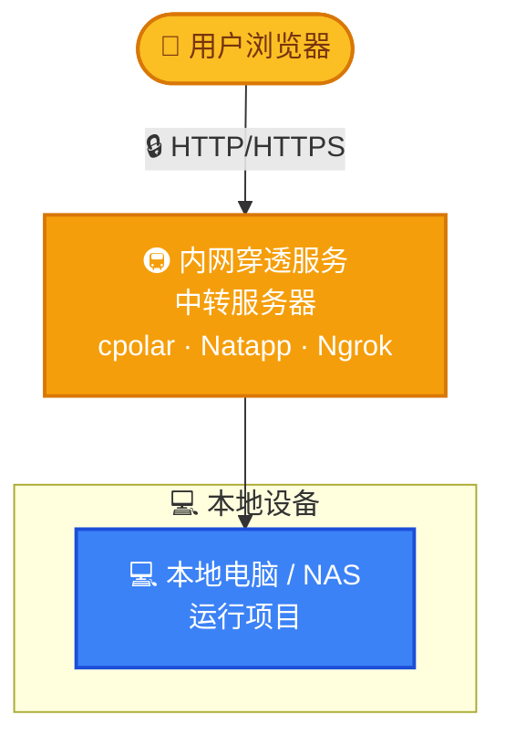

#### 步骤详解

**Step 1: 🆓 获取免费域名**

选择 EU.org 或其他免费域名服务（参考 [2.1 免费域名方案](#21-免费域名方案)）

**Step 2: 🚇 安装内网穿透工具**

以 cpolar 为例：

```bash
# Windows 用户
# 1. 访问 https://www.cpolar.com/ 下载安装包
# 2. 一键安装，注册账号登录

# Linux 用户
curl https://get.cpolar.sh | sh
cpolar authtoken YOUR_AUTH_TOKEN
cpolar http 8080
```

**Step 3: 🔗 绑定自定义域名（可选，需付费）**

1. 升级 cpolar 到付费套餐（或使用其他支持自定义域名的服务）
2. 在内网穿透平台添加 CNAME 记录指向穿透地址
3. 配置免费域名的 DNS 解析

**Step 4: 🚀 启动本地项目**

```bash
# 进入项目目录
cd d:\softWare\develop\app-myself\fitness\fitness-app

# 安装依赖
npm install

# 启动H5开发服务器
npm run dev:h5
# 默认监听 localhost:8080
```

**Step 5: 🚇 启动内网穿透**

```bash
# 新开终端窗口
cpolar http 8080

# ✅ 输出示例:
# Forwarding    https://xxxxxx.cpolar.top -> http://localhost:8080
```

**Step 6: 🎉 分享访问地址**

将生成的 `https://xxxxxx.cpolar.top` 地址分享给他人即可访问。

> ⚠️ 免费版地址会在24小时后变化，如需固定地址请升级付费套餐。

---

### 5.3 🏆 方案三：Cloudflare Tunnel 部署（零成本·强烈推荐）

> 🎯 **适用场景**: 长期运行的个人项目 · 家庭NAS · IoT设备暴露
> 
> 💰 **预估成本**: ¥0（需一个域名，最低 $0.99/年）
> 
> ✅ **优势**: 完全免费 · 固定域名 · 自动HTTPS · 隐藏真实IP

#### 前提条件

- 一个域名（可以是便宜的或免费的，只要能托管到Cloudflare）

#### 步骤详解

**Step 1: 🌐 准备域名**

按照 [3.1 Cloudflare 托管流程](#31-cloudflare-托管流程推荐) 将域名托管到 Cloudflare

**Step 2: 💻 安装 cloudflared**

```bash
# Windows (PowerShell)
winget install Cloudflare.cloudflared

# 验证安装
cloudflared --version
```

**Step 3: 🔑 登录授权**

```bash
cloudflared tunnel login
```

> 执行后会打开浏览器，选择你要使用的域名进行授权。

**Step 4: 🚇 创建并配置隧道**

```bash
# 创建隧道
cloudflared tunnel create fitness-app

# 编辑配置文件
notepad %USERPROFILE%\.cloudflared\config.yml
```

**config.yml 配置示例**：

```yaml
tunnel: <你的隧道ID>
credentials-file: C:\Users\<用户名>\.cloudflared\<隧道ID>.json

ingress:
  # 📱 主站 - 映射到本地前端开发服务器
  - hostname: app.fitness-pro.com
    service: http://localhost:8080
  
  # ⚙️ API服务 - 映射到后端API
  - hostname: api.fitness-pro.com
    service: http://localhost:8888
  
  # 🚫 兜底规则 - 返回404
  - service: http_status:404
```

**Step 5: 📡 配置DNS路由**

```bash
# 将子域名指向隧道
cloudflared tunnel route dns fitness-app app.fitness-pro.com
cloudflared tunnel route dns fitness-app api.fitness-pro.com
```

或在 Cloudflare Dashboard 手动添加 CNAME 记录：

| 类型 | 名称 | 目标 | 代理状态 |
|:----:|:----:|------|:--------:|
| CNAME | app | `<隧道ID>.cfargotunnel.com` | ☁️ 已代理 |
| CNAME | api | `<隧道ID>.cfargotunnel.com` | ☁️ 已代理 |

**Step 6: 🚀 启动隧道**

```bash
# 前台运行（测试用）
cloudflared tunnel run fitness-app

# 后台运行（Windows服务）
cloudflared service install
```

**Step 7: 🔄 设置开机自启（Windows）**

```powershell
# 以管理员身份运行 PowerShell
cloudflared service install

# 启动服务
Start-Service cloudflared

# 设置为自动启动
Set-Service -Name cloudflared -StartupType Automatic
```

**Step 8: ✅ 验证访问**

```bash
curl https://app.fitness-pro.com
curl https://api.fitness-pro.com
```

#### 完整架构图

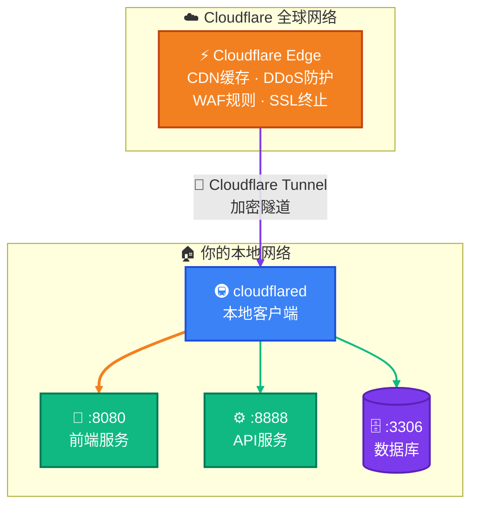

---

### 5.4 💰 三种方案总体拥有成本（TCO）对比

> 💡 以下为**年度总成本**估算，帮助你根据预算选择最合适的方案

#### 📊 成本明细对比

| 费用项 | 🖥️ 方案一<br>域名+云服务器 | 🚇 方案二<br>免费域名+内网穿透 | 🏆 方案三<br>CF Tunnel |
|:------:|:------------------------:|:---------------------------:|:---------------------:|
| 🛒 域名 | $0.99-$10/年 | 🆓 免费 | $0.99-$10/年 |
| 🖥️ 服务器 | ¥600-1200/年 | 🆓 无 | 🆓 无 |
| ☁️ DNS托管 | 🆓 Cloudflare免费 | 🆓 免费 | 🆓 Cloudflare免费 |
| 🔒 SSL证书 | 🆓 Cloudflare免费 | 🆓 穿透服务自带 | 🆓 Cloudflare免费 |
| 🚇 内网穿透 | — | ¥0-588/年 | 🆓 CF Tunnel免费 |
| 🛡️ DDoS防护 | 🆓 Cloudflare免费 | ❌ 无 | 🆓 Cloudflare免费 |
| ⚡ CDN加速 | 🆓 Cloudflare免费 | ❌ 无 | 🆓 Cloudflare免费 |
| 📊 带宽限制 | 服务器带宽 | 穿透服务限制 | CF Fair Use |
| 🔧 运维难度 | ⭐⭐⭐ | ⭐⭐ | ⭐ |
| 📈 可扩展性 | ⭐⭐⭐⭐⭐ | ⭐⭐ | ⭐⭐⭐⭐ |
| 🏗️ 稳定性 | ⭐⭐⭐⭐⭐ | ⭐⭐⭐ | ⭐⭐⭐⭐ |

#### 💵 年度总成本

| 方案 | 🆓 最低成本 | 💰 典型成本 | 💎 高配成本 |
|:----:|:----------:|:----------:|:----------:|
| 🖥️ 方案一 | ¥600/年 | ¥1000/年 | ¥3000+/年 |
| 🚇 方案二 | ¥0/年 | ¥0/年 | ¥588/年 |
| 🏆 方案三 | ¥7/年 | ¥70/年 | ¥70/年 |

> 🏆 **结论**: 个人项目首选**方案三**（Cloudflare Tunnel），年成本仅 ¥7-70，同时享受 CDN + SSL + DDoS 防护。有预算且需要高稳定性的生产环境选**方案一**。

#### 📋 方案选择决策流程

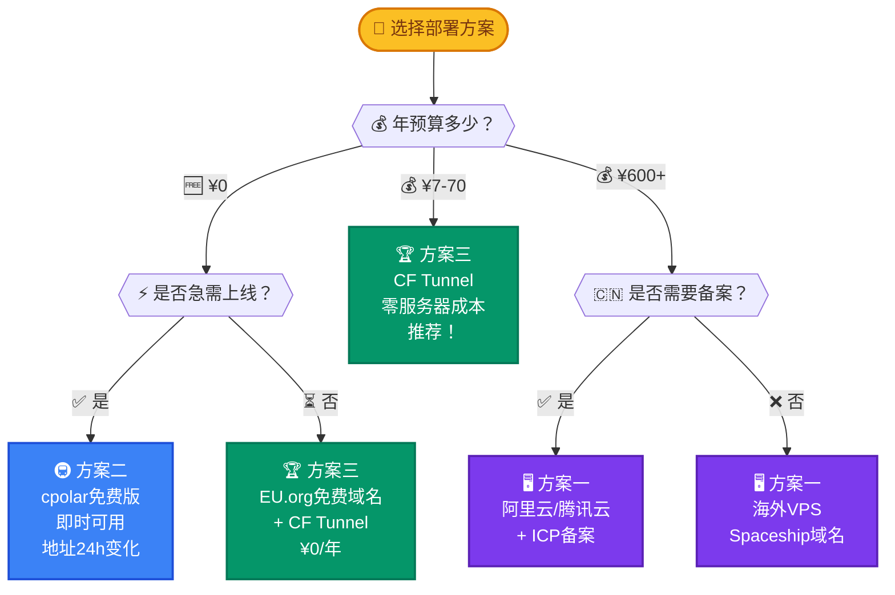

---

## 六、常见问题与故障排查

### ❓ Q1: 域名无法访问，提示 `DNS_PROBE_FINISHED_NXDOMAIN`

**原因**: DNS记录未正确配置或尚未生效

**解决方案**：

```bash
# 检查DNS是否生效
nslookup yourdomain.com
dig yourdomain.com
```

**排查清单**：

- [ ] Cloudflare DNS记录是否添加正确
- [ ] 名称服务器是否已成功切换
- [ ] 等待DNS传播（最长48小时）

---

### ❓ Q2: Cloudflare 显示 5xx 错误

**原因**: 源站不可达或配置错误

**排查步骤**：

> ① 检查源站服务器是否正常运行
> 
> ② 尝试将代理状态改为 **DNS only**（灰色云朵）测试
> 
> ③ 检查防火墙是否放行了 Cloudflare IP段
> 
> ④ 查看 Cloudflare 的 SSL/TLS 设置是否匹配源站

---

### ❓ Q3: 内网穿透连接不稳定

| 方案 | 解决方法 |
|------|----------|
| 付费服务 | 获得更稳定的带宽 |
| FRP | 启用心跳保活 |
| Cloudflare Tunnel | ✅ 已内置自动重连 |

---

### ❓ Q4: 如何实现 HTTPS？

| 方案 | 操作 | 难度 |
|------|------|:----:|
| ☁️ **Cloudflare** | 开启后自动提供，无需额外配置 | ⭐ |
| 🌐 Nginx + Let's Encrypt | `certbot --nginx -d yourdomain.com` | ⭐⭐ |
| 🚇 内网穿透 | 大多数穿透服务自带HTTPS | ⭐ |

---

### ❓ Q5: 国内网站需要备案吗？

| 场景 | 是否需要备案 |
|------|:----------:|
| 🇨🇳 国内服务器 + 国内域名 | ✅ 需要 |
| 🌍 海外服务器 | ❌ 不需要 |
| 🧪 仅用于测试/学习 | 视情况而定 |

---

## 七、安全建议

### 🔒 7.1 基本安全措施

- [ ] 🔒 开启 HTTPS（强制跳转）
- [ ] 🙈 隐藏服务器版本信息
- [ ] 🛡️ 配置安全的响应头
- [ ] 📦 定期更新依赖包
- [ ] 🔑 使用强密码和双因素认证

---

### 🛡️ 7.2 Nginx 安全配置

```nginx
# 隐藏版本号
server_tokens off;

# 安全响应头
add_header X-Frame-Options "SAMEORIGIN" always;
add_header X-Content-Type-Options "nosniff" always;
add_header X-XSS-Protection "1; mode=block" always;
add_header Referrer-Policy "no-referrer-when-downgrade" always;

# 限制请求大小
client_max_body_size 10m;

# 速率限制
limit_req_zone $binary_remote_addr zone=api_limit:10m rate=10r/s;

location /api {
    limit_req zone=api_limit burst=20 nodelay;
    proxy_pass http://localhost:8888;
}
```

---

### ☁️ 7.3 Cloudflare 安全设置

| 设置项 | 推荐值 | 说明 |
|--------|:------:|------|
| 安全级别 | Medium | 平衡安全和体验 |
| 质询通过期 | 30分钟 | 减少重复验证 |
| 浏览器完整性检查 | ✅ 开启 | 防止恶意爬虫 |
| 热链保护 | ✅ 开启 | 保护带宽 |
| Bot管理模式 | ✅ 开启 | 过滤恶意流量 |

---

### 🛡️ 7.4 Cloudflare Security Level 配置与 API 放行指南

> ⚠️ **重要**: 如果 Cloudflare 的 Security Level 设置为 `I'm Under Attack`，所有 API 请求都会被 JS Challenge 拦截，导致 `uni.request` 等非浏览器请求完全无法通过。这是部署后最常见的故障之一。

#### 🔍 问题现象

| 现象 | 原因 |
|------|------|
| API 请求返回 HTML 而非 JSON | Cloudflare JS Challenge 拦截 |
| 前端所有接口报网络错误 | `uni.request` 无法执行 JS 验证 |
| 浏览器直接访问域名出现 "Just a moment..." | Under Attack Mode 生效 |
| `curl` 请求返回 403 或 JS 代码 | 非浏览器请求被拦截 |

#### 📖 Security Level 各级别说明

| 级别 | 行为 | 适用场景 |
|:----:|------|----------|
| **Essentially Off** | 不做任何安全检查 | 纯 API 服务、内网工具 |
| **Low** | 只拦截已知恶意IP | 低风险项目 |
| **Medium** | 拦截可疑请求 | 🏆 **推荐**：大多数项目 |
| **High** | 严格检查所有请求 | 高风险业务 |
| **I'm Under Attack** | 所有访问者必须通过 JS 验证 | 正在被攻击时临时启用 |

> ⚠️ **`I'm Under Attack` 模式下，所有非浏览器请求（API、小程序、App）都会被拦截！**

#### 🔧 方法一：通过 Cloudflare Dashboard 修改 Security Level

**步骤**：

> **Step 1** → 登录 [Cloudflare Dashboard](https://dash.cloudflare.com/)
> 
> **Step 2** → 点击你的域名（如 `zzy404notfound.site`）
> 
> **Step 3** → 左侧菜单 → **Security** → **Settings**
> 
> **Step 4** → 找到 **Security Level** 卡片
> 
> **Step 5** → 点击右侧下拉框，从 `I'm Under Attack` 改为 **`Medium`**
> 
> **Step 6** → 自动保存，立即生效

#### 🔧 方法二：通过 Cloudflare API 修改 Security Level（推荐）

> 💡 当 Dashboard 界面找不到设置项时，使用 API 是最可靠的方式

**前置准备**：

1. 登录 Cloudflare Dashboard
2. 右上角头像 → **My Profile** → **API Tokens** → **Create Token**
3. 选择 **Create Custom Token**
4. 配置权限：
   - **Token name**: `security-settings`
   - **Permissions**: **Zone** → **Settings** → **Edit**
   - **Zone Resources**: **All zones** 或指定域名
5. 点击 **Continue to summary** → **Create Token**
6. ⚠️ 复制 Token（只显示一次！）

**获取 Zone ID**：

> 在 Cloudflare Dashboard → 你的域名 → 右侧 **API** 区域 → 复制 **Zone ID**

**查看当前 Security Level**：

```powershell
$headers = @{
    "Authorization" = "Bearer 你的API_TOKEN"
    "Content-Type"  = "application/json"
}

Invoke-RestMethod `
    -Uri "https://api.cloudflare.com/client/v4/zones/你的ZONE_ID/settings/security_level" `
    -Method GET `
    -Headers $headers | ConvertTo-Json
```

**修改 Security Level 为 Medium**：

```powershell
$headers = @{
    "Authorization" = "Bearer 你的API_TOKEN"
    "Content-Type"  = "application/json"
}
$body = @{ value = "medium" } | ConvertTo-Json

Invoke-RestMethod `
    -Uri "https://api.cloudflare.com/client/v4/zones/你的ZONE_ID/settings/security_level" `
    -Method PATCH `
    -Headers $headers `
    -Body $body | ConvertTo-Json
```

**本项目实际操作记录**（`zzy404notfound.site`）：

```powershell
# 查询当前状态 → 返回 "under_attack"
Invoke-RestMethod -Uri "https://api.cloudflare.com/client/v4/zones/145cff77be6072e82f876544abffe5d0/settings/security_level" -Method GET -Headers $headers

# 修改为 medium → 返回 "medium"，成功！
$body = @{ value = "medium" } | ConvertTo-Json
Invoke-RestMethod -Uri "https://api.cloudflare.com/client/v4/zones/145cff77be6072e82f876544abffe5d0/settings/security_level" -Method PATCH -Headers $headers -Body $body
```

#### 🔧 方法三：通过 WAF Custom Rules 放行 API（付费版可用）

> 💡 如果你使用 Cloudflare 付费版，可以保持 `I'm Under Attack` 不变，仅对 API 路径放行

**步骤**：

> **Step 1** → 左侧菜单 → **Security** → **WAF** → **Custom Rules**
> 
> **Step 2** → 点击 **Create Rule**
> 
> **Step 3** → 配置：
> - **Rule name**: `Allow API Requests`
> - 点击 **Edit expression**，输入：
>   ```
>   (http.request.uri.path starts with "/api")
>   ```
> - **Action**: 选择 **Skip**
> - 勾选 ✅ **Security Level Check**
> 
> **Step 4** → 点击 **Deploy**

> ⚠️ **免费版没有 WAF 功能**，如需此功能需升级到 Pro 计划（$20/月）

#### ✅ 验证 Security Level 修改是否生效

```powershell
# 测试1: 直接请求 API（应返回业务响应，而非 JS Challenge 页面）
try {
    $r = Invoke-RestMethod -Uri "https://zzy404notfound.site/api/users/login" `
        -Method POST -Headers @{"Content-Type"="application/json"} `
        -Body '{"username":"test","password":"test"}' -UseBasicParsing
    $r | ConvertTo-Json
} catch {
    "Status: $($_.Exception.Response.StatusCode.value__)"
}

# 预期结果：
# - 修改前: 返回 HTML 页面（包含 "Just a moment..." 和 JS 代码）
# - 修改后: 返回 JSON 业务响应（如 {"flag":false,"code":400,"message":"用户不存在"}）
#           或 401 状态码（未携带 Token）

# 测试2: 通过 Cloudflare API 确认当前设置
Invoke-RestMethod -Uri "https://api.cloudflare.com/client/v4/zones/你的ZONE_ID/settings/security_level" `
    -Method GET -Headers $headers | ConvertTo-Json

# 预期结果: "value": "medium"
```

#### 📋 Security Level 配置决策树

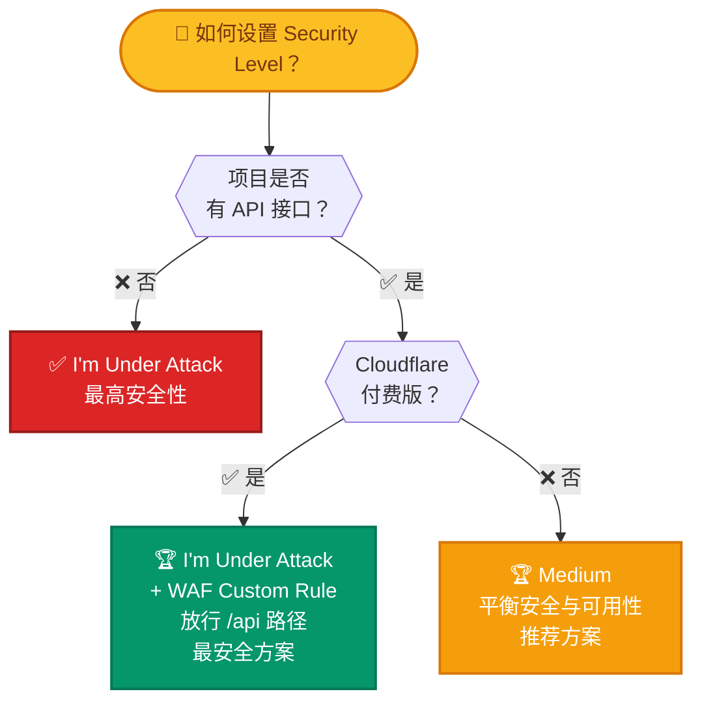

#### ⚠️ 注意事项

| 事项 | 说明 |
|------|------|
| 🔒 API Token 安全 | 不要将 Token 提交到 Git 仓库，使用后可在 Cloudflare 后台 **Revoke** |
| 🔄 生效时间 | Security Level 修改后通常 **即时生效**，少数情况需等待 1-2 分钟 |
| 🛡️ 安全权衡 | `Medium` 级别仍能防护大部分恶意请求，同时不影响正常 API 调用 |
| 📱 小程序/App | 所有非浏览器 HTTP 客户端都无法通过 JS Challenge，必须放行 |
| 🧪 测试方法 | 用 `curl` 或 `Invoke-RestMethod` 测试，浏览器测试无法发现此问题 |
| 🔄 恢复攻击模式 | 如果遭遇攻击，可临时改回 `under_attack`，攻击结束后再改回 `medium` |

---

## 八、健身小助手项目关键配置细节

> 🎯 本章针对本项目 `fitness-app` 的实际代码结构，列出部署时**必须注意**的配置要点。

### 📁 8.1 项目架构概览

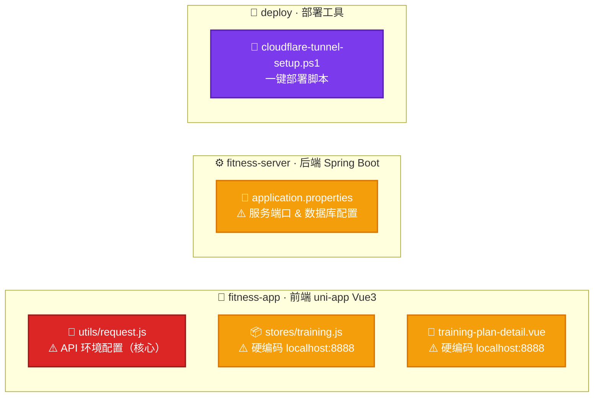

---

### ⚠️ 8.2 必须修改的配置文件清单

#### 📄 文件1: `fitness-app/utils/request.js`（🔴 最重要）

这是前端 API 请求的核心配置文件，当前配置：

```javascript
// ❌ 当前配置（需修改）
const ENV_CONFIG = {
    development: 'http://localhost:8888/api',
    debug: 'http://192.168.1.100:8888/api',
    production: 'https://5f655411.r3.cpolar.top/api',  // ← 当前用的 cpolar
};
const CURRENT_ENV = 'production';
```

**部署到 Cloudflare 后需改为**：

```javascript
// ✅ 修改后（本项目实际配置）
const ENV_CONFIG = {
    development: 'http://localhost:8888/api',
    debug: 'http://192.168.1.100:8888/api',
    production: 'https://zzy404notfound.site/api',     // ← Cloudflare 域名
};
const CURRENT_ENV = 'production';
```

> ⚠️ **踩坑记录**: `production` 地址必须使用 `https`，且路径末尾带 `/api`。Cloudflare 会自动提供 SSL 证书，无需额外配置。

---

#### 📄 文件2: `fitness-app/stores/training.js`

```javascript
// ❌ 当前（第1行硬编码）
const API_BASE = 'http://localhost:8888'

// ✅ 应改为（本项目实际配置）
const API_BASE = 'https://zzy404notfound.site'

// 💡 最佳实践：从 request.js 导入，避免多处硬编码
import { API_BASE_URL } from '@/utils/request';
const API_BASE = API_BASE_URL.replace(/\/api$/, '');
```

---

#### 📄 文件3: `fitness-app/pages/knowledge/training-plan-detail.vue`

```javascript
// ❌ 当前（第191行硬编码）
const API_BASE = "http://localhost:8888";

// ✅ 应改为（本项目实际配置）
const API_BASE = "https://zzy404notfound.site";

// 💡 最佳实践：从 request.js 导入，避免多处硬编码
import { API_BASE_URL } from '@/utils/request';
const API_BASE = API_BASE_URL.replace(/\/api$/, '');
```

---

#### 📄 文件4: `fitness-server/src/main/resources/application.properties`

```properties
# 服务端口（保持 8888 不变）
server.port=8888

# 数据库配置（确保 MySQL 已启动且数据库已创建）
spring.datasource.url=jdbc:mysql://localhost:3306/fitness?useUnicode=true&characterEncoding=UTF-8&serverTimezone=Asia/Shanghai&useSSL=false
spring.datasource.username=root
spring.datasource.password=your_password   # ← 修改为你的 MySQL 密码

# 文件上传目录
app.upload.dir=uploads
```

---

### 🔗 8.3 Cloudflare 域名映射与项目端口对应关系

> 💡 本项目使用 Cloudflare 直接将域名 `zzy404notfound.site` 映射到本地 8888 端口，无需 Cloudflare Tunnel。

#### 📋 域名映射完整操作流程

**Step 1: 在 Cloudflare 添加域名**

> ① 登录 [Cloudflare Dashboard](https://dash.cloudflare.com/)
> 
> ② 点击 **添加站点** → 输入域名 `zzy404notfound.site`
> 
> ③ 选择 **Free** 套餐 → 确认 DNS 记录

**Step 2: 在域名注册商修改 NS 记录**

> ① 复制 Cloudflare 提供的两个 Nameserver 地址
> 
> ② 到域名注册商后台修改 NS 为 Cloudflare 的地址
> 
> ③ 等待 NS 生效（10分钟 ~ 24小时）

**Step 3: 配置 DNS 记录**

> ① 在 Cloudflare Dashboard → **DNS** → **Records**
> 
> ② 添加 A 记录或 CNAME 记录，将域名指向本地服务

| 类型 | 名称 | 目标 | 代理状态 | 说明 |
|:----:|:----:|------|:--------:|------|
| A | `@` | 你的公网IP | ☁️ 已代理 | 根域名直接访问 |
| A | `api` | 你的公网IP | ☁️ 已代理 | API 子域名 |
| CNAME | `@` | `<隧道ID>.cfargotunnel.com` | ☁️ 已代理 | 使用 Tunnel 时 |

> ⚠️ **本项目场景**: 如果使用 Cloudflare Tunnel，则添加 CNAME 记录指向隧道；如果本地有公网 IP，则添加 A 记录。

**Step 4: 配置 Cloudflare Tunnel（如需内网穿透）**

```yaml
tunnel: <你的隧道ID>
credentials-file: C:\Users\<用户名>\.cloudflared\<隧道ID>.json

ingress:
  - hostname: zzy404notfound.site
    service: http://localhost:8888
  - hostname: www.zzy404notfound.site
    service: http://localhost:8888
  - service: http_status:404
```

**Step 5: 修改 Security Level**

> ⚠️ **关键步骤！** 新添加的域名默认 Security Level 可能是 `I'm Under Attack`，会导致所有 API 请求被拦截！

参考 [7.4 Cloudflare Security Level 配置与 API 放行指南](#74-cloudflare-security-level-配置与-api-放行指南) 将其修改为 **Medium**。

**Step 6: 修改前端 API 配置**

将以下三个文件中的 `localhost:8888` 或 `cpolar` 地址替换为 `https://zzy404notfound.site`：

| 文件 | 修改项 | 修改后 |
|------|--------|--------|
| `utils/request.js` | `ENV_CONFIG.production` | `https://zzy404notfound.site/api` |
| `stores/training.js` | `API_BASE` | `https://zzy404notfound.site` |
| `pages/knowledge/training-plan-detail.vue` | `API_BASE` | `https://zzy404notfound.site` |

**Step 7: 验证部署**

```powershell
# 测试 API 连通性（应返回 JSON 业务响应）
Invoke-RestMethod -Uri "https://zzy404notfound.site/api/users/login" `
    -Method POST -Headers @{"Content-Type"="application/json"} `
    -Body '{"username":"test","password":"test"}' -UseBasicParsing

# 预期结果: {"flag":false,"code":400,"message":"用户不存在","data":null}
# 如果返回 HTML 或 403 → Security Level 未修改，参考 7.4 节
```

#### 架构对应关系

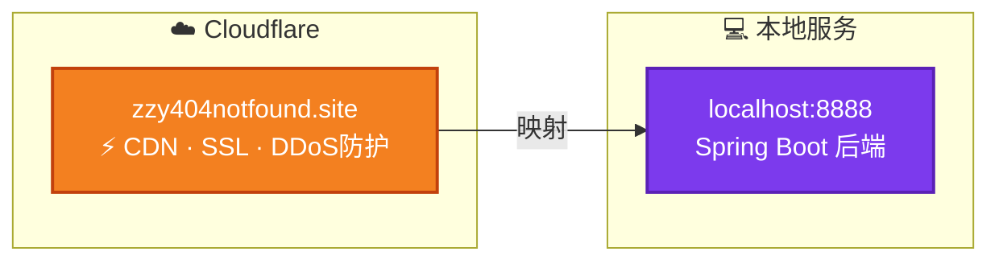

> ⚠️ **关键**: 前端 `request.js` 中的 `production` 地址必须与 Cloudflare 映射的域名一致，且路径末尾带 `/api`。

---

### ✅ 8.4 部署前检查清单

- [ ] 🗄️ MySQL 已启动，fitness 数据库已创建
- [ ] ⚙️ 后端 Spring Boot 已启动，`localhost:8888` 可访问
- [ ] 📱 前端开发服务器已启动，`localhost:8080` 可访问
- [ ] 🔧 `request.js` 中 production URL 已修改为 `https://zzy404notfound.site/api`
- [ ] 📦 `stores/training.js` 硬编码 URL 已替换为 `https://zzy404notfound.site`
- [ ] 📄 `training-plan-detail.vue` 硬编码 URL 已替换为 `https://zzy404notfound.site`
- [ ] 🌐 `CURRENT_ENV` 设置为 `'production'`
- [ ] ☁️ 域名已托管到 Cloudflare
- [ ] 📡 DNS 记录已添加（A 记录或 CNAME 记录）
- [ ] 🛡️ **Security Level 已设置为 `Medium`**（⚠️ 必须检查！否则 API 会被拦截）
- [ ] 🧪 API 连通性已验证（`Invoke-RestMethod` 返回 JSON 而非 HTML）

---

### 🔄 8.5 从 cpolar 迁移到 Cloudflare Tunnel

你当前使用 cpolar（`https://5f655411.r3.cpolar.top/api`），迁移步骤：

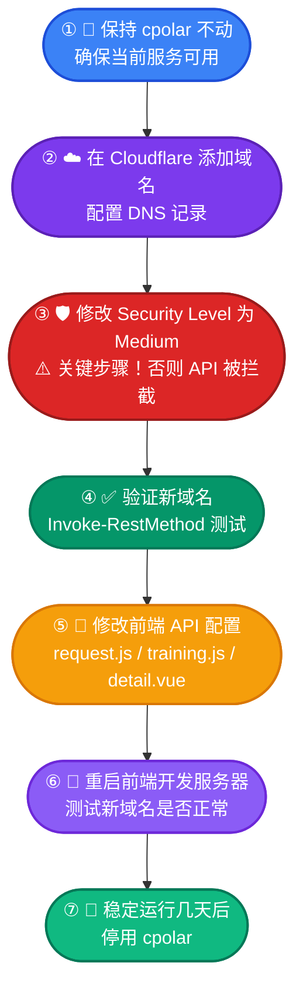

---

### 🚀 8.6 一键部署脚本使用说明

脚本位置：`deploy\cloudflare-tunnel-setup.ps1`

```powershell
# ═══════ 使用前先修改脚本顶部的配置区 ═══════
$DOMAIN = "your-domain.com"       # ← 改为你的域名
$APP_SUBDOMAIN = "app"            # ← 前端子域名
$API_SUBDOMAIN = "api"            # ← 后端子域名
$FRONTEND_PORT = 8080             # ← 前端端口
$BACKEND_PORT = 8888              # ← 后端端口

# ═══════ 运行脚本 ═══════
cd d:\softWare\develop\app-myself\fitness\deploy
.\cloudflare-tunnel-setup.ps1
```

**脚本交互菜单**：

| 选项 | 功能 | 说明 |
|:----:|------|------|
| `[1]` | 🔄 完整部署 | 推荐首次使用，依次执行所有步骤 |
| `[7]` | 🚇 仅启动隧道 | 日常使用 |
| `[8]` | 🔧 安装为系统服务 | 开机自启 |
| `[9]` | 📊 查看隧道状态 | 查看当前隧道列表 |

---

## 九、免费域名注册详细指南

### 🥇 9.1 推荐方案：EU.org

> 🏆 **唯一可托管到 Cloudflare 免费计划的免费域名方案**

| 项目 | 详情 |
|------|------|
| 🔗 注册地址 | https://nic.eu.org/ |
| 🌐 域名格式 | `yourname.eu.org` |
| 💰 费用 | 🆓 永久免费，无需续期 |
| ⏳ 审核时间 | 3-7个工作日 |
| ☁️ Cloudflare兼容 | ✅ 完全支持 |
| 📅 稳定性 | ⭐⭐⭐⭐⭐ (始于1996年) |

**详细注册流程**：

> **Step 1** 📝 **创建账号**
> - 访问 https://nic.eu.org/
> - 点击页面上的 **Register** 链接
> - 填写用户名、邮箱、密码
> - 完成 reCAPTCHA 验证 → 提交注册

> **Step 2** 📧 **验证邮箱**
> - 登录注册邮箱查收验证邮件
> - 点击验证链接完成账号激活

> **Step 3** 🌐 **申请域名**
> - 登录后台 → 点击 **New Domain** 或 **Apply for a domain**
> - 选择 **Second-level domain**
> - 输入你想要的域名前缀（如 `fitness-app`）
> - 完整域名将是 `fitness-app.eu.org`

> **Step 4** 📡 **填写 DNS 信息**
> - 在申请页面填写名称服务器：
> ```
> Nameserver 1: xxx.ns.cloudflare.com
> Nameserver 2: yyy.ns.cloudflare.com
> ```
> - 💡 先在 Cloudflare 添加这个域名（参考第三章），获取 NS 地址后再填入

> **Step 5** 📝 **填写用途说明**（英文）
> ```
> Personal fitness tracking web application for 
> workout logging, diet tracking, and health monitoring.
> ```

> **Step 6** ⏳ **等待审核**（通常 3-7 个工作日，通过后邮件通知）

---

### 🥈 9.2 备选方案：DNSHe

| 项目 | 详情 |
|------|------|
| 🔗 注册地址 | https://my.dnshe.com/register.php |
| 🌐 支持后缀 | `.tk` `.ml` `.ga` `.cf` `.gq` |
| 💰 费用 | 🆓 免费（每人最多3个） |
| ⏳ 审核时间 | ⚡ 即时生效 |
| ☁️ Cloudflare兼容 | ✅ 支持 |

**注册流程**：

> ① 访问 https://my.dnshe.com/register.php 注册账号
> 
> ② 登录后点击左侧 **免费域名**
> 
> ③ 选择后缀（推荐 `.ml` 或 `.ga`），输入前缀
> 
> ④ 点击申请，⚡ 即时生效
> 
> ⑤ 进入 **DNS服务器** 页面，将 NS 改为 Cloudflare 的地址

---

### 🥉 9.3 备选方案：deSEC

| 项目 | 详情 |
|------|------|
| 🔗 注册地址 | https://desec.io/ |
| 🌐 域名格式 | `yourname.dedyn.io` |
| 💰 费用 | 🆓 免费 |
| ☁️ Cloudflare兼容 | ✅ 支持 |

**注册流程**：

> ① 访问 https://desec.io/ 创建账号
> 
> ② 验证邮箱后登录
> 
> ③ 创建新域名（如 `fitness-app.dedyn.io`）
> 
> ④ 在 Cloudflare 中添加此域名
> 
> ⑤ 将 deSEC 的 NS 记录改为 Cloudflare 提供的 NS 地址

---

### 💰 9.4 付费推荐：Spaceship

| 项目 | 详情 |
|------|------|
| 🔗 注册地址 | https://www.spaceship.com/ |
| 💳 支付方式 | 💚 **支付宝**（国内用户友好） |
| 💲 .com 首年 | 约 **$0.99-$9.99** |
| 🔒 WHOIS 隐私 | 🆓 免费赠送 |

**注册流程**：

> ① 访问 https://www.spaceship.com/ → 点击 **Sign Up** 注册
> 
> ② 在搜索框输入想要的域名（如 `fitness-pro`）
> 
> ③ 选择后缀和价格（推荐 `.com` 或 `.net`）
> 
> ④ 加入购物车，确保 **Domain Privacy** 已开启（🆓免费）
> 
> ⑤ 使用 💚 **支付宝** 完成支付
> 
> ⑥ 在 **Domain Manager** 中管理域名

---

### 🔍 9.5 域名比价工具

| 工具 | 地址 | 说明 |
|------|------|------|
| 🔎 TLD-List | https://tld-list.com/ | 全球域名后缀比价 |
| 🔎 Domcomp | https://www.domcomp.com/ | 注册商价格对比 |
| 🔎 NameBio | https://namebio.com/ | 域名交易历史价格 |

---

### 📅 9.6 免费域名 + Cloudflare Tunnel 完整操作时间线

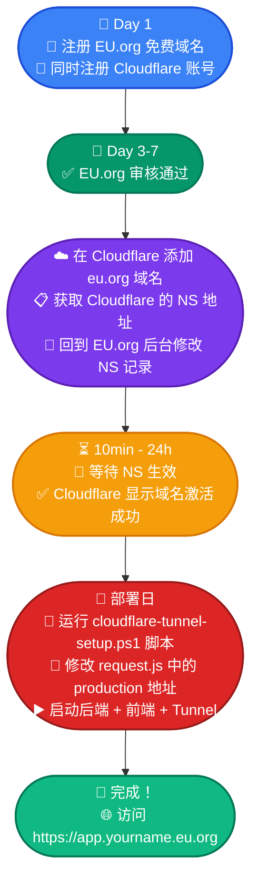

---

## 📎 附录

### 🛒 域名购买速查

| 预算 | 推荐平台 | 价格 | 备注 |
|:----:|:--------:|:----:|------|
| 🆓 ¥0 | EU.org | 免费 | 审核3-7天 |
| 🆓 ¥0 | DNSHe | 免费 | 即时可用 |
| 💰 ¥7-70 | Spaceship | $0.99+/年 | 💚 支付宝付款 |
| 💰 ¥29+ | 阿里云 | ¥29+/年 | 🇨🇳 备案方便 |

### 🚇 内网穿透速查

| 需求 | 推荐工具 | 费用 |
|------|:--------:|:----:|
| ⚡ 快速测试 | Ngrok | 🆓 |
| 🔄 长期使用 | cpolar | 🆓/¥49月起 |
| 🔧 自建服务 | FRP | 🆓(需服务器) |
| 🏆 最佳方案 | Cloudflare Tunnel | 🆓 |

### 💻 常用命令速查

```bash
# 📡 DNS查询
nslookup domain.com
dig domain.com

# 🔒 SSL检查
openssl s_client -connect domain.com:443 -servername domain.com

# 🚇 Cloudflare Tunnel
cloudflared tunnel list
cloudflared tunnel run <name>

# 🔧 FRP
./frps -c frps.toml   # 服务端
./frpc -c frpc.toml   # 客户端
```

---

## 🔗 参考资源

| 资源 | 链接 |
|------|------|
| 📖 原文参考 | [CSDN - Spaceship 域名托管到 Cloudflare](https://blog.csdn.net/qq_42072085/article/details/160965108) |
| ☁️ Cloudflare 官方文档 | https://developers.cloudflare.com/ |
| 🚇 Cloudflare Tunnel 文档 | https://developers.cloudflare.com/cloudflare-one/connections/connect-networks/ |
| 🔧 FRP 中文文档 | https://gofrp.org/zh-cn/docs/ |
| 🚇 cpolar 文档中心 | https://www.cpolar.com/docs |
| 🔍 域名比价网站 | https://tld-list.com/ |
| 📊 内网穿透工具对比 | https://cloud.tencent.cn/developer/article/2656584 |
| 🆓 EU.org 免费域名 | https://nic.eu.org/ |
| 🆓 DNSHe 免费域名 | https://my.dnshe.com/ |
| 🆓 deSEC 免费 DNS | https://desec.io/ |
| 💰 Spaceship 域名购买 | https://www.spaceship.com/ |

---

<div align="center">

**📄 文档版本 v2.2** · **📅 更新于 2026-05-26** · **🏋️ 适用于健身小助手项目部署**

</div>
